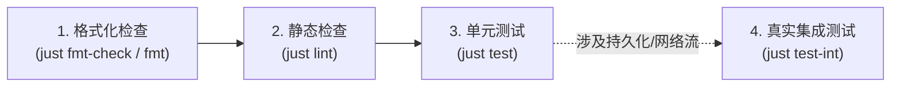

# bgin - AI Coding Agent 研发与协作总纲 (AGENTS.md)

本文档是针对接入本仓库的所有 AI Coding Agent（如 Claude Code, Antigravity, Cursor, Windsurf 等）的核心认知与工程操作总纲。Agent 在本仓库执行任何探索、设计、编码、重构、审查或排错任务时，**必须严格遵守本规范及所索引的专责规则**。

---

## 1. 项目概览与技术拓扑 (Project Overview & Tech Stack)

`bgin` 是一个基于现代化 Go 语言规范构建的企业级高并发 RESTful Web API 骨架。

- **运行时与语言规范**：[Go 1.27+](file:///Users/seaside/Projects/go/gin-bun/go.mod) 现代标准，开启严格并发安全与类型安全。
- **Web 引擎**：[Gin](file:///Users/seaside/Projects/go/gin-bun/internal/bootstrap/engine.go) (`github.com/gin-gonic/gin`)，统一错误恢复、链路追踪、CORS 与限流中间件。
- **数据库与 ORM**：[Bun ORM](file:///Users/seaside/Projects/go/gin-bun/internal/database/client.go) (`uptrace/bun`) + [pgx/v5 原生连接池](file:///Users/seaside/Projects/go/gin-bun/internal/database/client.go) (`jackc/pgx/v5`)，底层运行 PostgreSQL 18。
- **数据库迁移 (Migrations)**：[Atlas CLI](file:///Users/seaside/Projects/go/gin-bun/atlas.hcl)，采用声明式 Schema 驱动的版本化 SQL 迁移。
- **缓存体系**：[Valkey (Redis 兼容)](file:///Users/seaside/Projects/go/gin-bun/internal/platform/cache/cache.go) + 高性能驱动 (`redis/rueidis`)。
- **鉴权与授权**：无状态 JWT 令牌 (`golang-jwt/jwt/v5`) + 基于 [Casbin v3](file:///Users/seaside/Projects/go/gin-bun/internal/platform/authz/authz.go) 的 RBAC 静态权限矩阵。
- **CLI 命令行体系**：基于 [`urfave/cli/v3`](file:///Users/seaside/Projects/go/gin-bun/internal/console/root.go) 的 Laravel Artisan 风格命令行系统。
- **对象存储与邮件**：S3/MinIO (`minio/minio-go/v7`) 与本地存储抽象；Mailpit 邮件测试系统 (`wneessen/go-mail`)。
- **结构化日志与错误处理**：`rs/zerolog` 结构化上下文日志；`samber/oops` 业务错误堆栈与语义化错误码。
- **接口契约与文档**：基于 [api.md](file:///Users/seaside/Projects/go/gin-bun/api.md) 契约，使用 `swag` 自动化生成 OpenAPI 规范并嵌入二进制。

---

## 2. 核心工作流与 Just 任务契约 (Core Workflows & Just Tasks)

本仓库所有常规开发、检查、迁移与测试操作**强制统一通过根目录 [justfile](file:///Users/seaside/Projects/go/gin-bun/justfile) 执行**。严禁 Agent 私自拼接长命令，避免漏传环境变量或构建标签。

> **终端执行红线**：所有命令在终端执行时必须前缀 `rtk`（如 `rtk just check`），且**绝对严禁执行 `cd` 改变工作目录**。

| 命令分类 | 执行指令 | 功能说明与关键约束 |
| :--- | :--- | :--- |
| **开发与运行** | `just dev` | Air 热重载启动（自动检测并释放占用端口）。 |
| | `just run [ARGS]` | 直接运行服务（如 `just run --port 3400`）。 |
| | `just build` | 编译可执行文件至 `bin/bgin`，自动注入 version/commit/date 元数据。 |
| **静态检查与格式化** | `just fmt` | 代码自动格式化并就地改写文件（基于 `golangci-lint fmt`）。 |
| | `just fmt-check` | 仅检查格式是否规范，不改写文件。 |
| | `just lint` | 静态检查（严格保持 0 警告 0 报错）。 |
| **测试套件** | `just test` | 执行全量单元测试（内存级快速执行）。 |
| | `just test-int` | 执行集成测试（需本地真实 Postgres/Valkey/Mailpit，打标签 `-tags=integration`）。 |
| | `just test-all` | 同时执行单元测试与集成测试。 |
| | `just coverage` | 统计覆盖率（必须携带 `-coverpkg=./internal/...` 解决外部测试包插桩问题）。 |
| **三级门禁** | `just check` | **交付前强制执行**：`fmt-check` + `lint` + `test`。 |
| | `just ci` | 完整 CI 门禁：`fmt-check` + `lint` + `test-all`。 |
| **数据库与迁移** | `just migrate` | 应用未执行的 Atlas 版本迁移（依赖本地 Postgres 5432）。 |
| | `just migrate-diff <name>` | 对比 `schema.sql` 生成新的版本迁移文件。 |
| | `just migrate-hash` | 重算 `migrations/` 目录的哈希完整性校验链。 |
| | `just seed` | 幂等注入首个管理员数据。 |
| | `just fresh` | 破坏性重建数据库并重新播种（需确认；自动化脚本可用 `just fresh-force`）。 |
| **API 文档生成** | `just docs` | 使用 `swag` 解析生成 OpenAPI 规范到 [apidocs/swagger.json](file:///Users/seaside/Projects/go/gin-bun/apidocs/swagger.json)。 |

---

## 3. 领域优先分层架构与依赖红线 (Domain-First Architecture & Boundaries)

项目采用**领域优先（Domain-First）**切片设计，结构清晰且边界严格：

```
cmd/api/main.go                 # 应用程序唯一入口，控制权移交 internal/console
internal/
├── bootstrap/                  # 依赖组装、引擎初始化与服务生命周期管理
├── config/                     # 基于 caarlos0/env 的强类型环境配置加载
├── console/                    # Artisan 风格 CLI 命令（serve, db:seed, db:fresh）
├── database/                   # Bun ORM 客户端初始化与实体定义
│   ├── model/                  # 数据库表实体模型（Account, User, Verification 等）
│   └── schema.sql              # 声明式目标 DDL（Atlas 迁移计算的事实源）
├── features/                   # 垂直领域切片（核心业务逻辑）
│   ├── admin/user/             # 管理端用户管理（routes, handler, service, dto, resource）
│   ├── auth/                   # 认证中心（登录/注册/密码重置/会话撤销）
│   ├── client/profile/         # 客户端个人资料
│   └── system/                 # 系统探针与元信息（healthz, readyz）
├── middleware/                 # 全局与路由级 HTTP 中间件（认证、限流、CORS、监控）
├── platform/                   # 横切基础设施与跨切片基座（纯原子组件）
│   ├── authz/                  # Casbin RBAC 静态策略与权限校验
│   ├── cache/                  # Valkey 客户端与缓存存取
│   ├── errs/                   # Oops 错误模型、全局错误码与多语言错误渲染
│   ├── hasher/                 # Argon2id / Bcrypt 密码哈希
│   ├── i18n/                   # 基于 TOML 的多语言字段与提示信息翻译
│   ├── identity/               # 上下文用户身份抽取
│   ├── logger/                 # Zerolog 结构化日志包装
│   ├── mailer/                 # SMTP 邮件发送抽象
│   ├── optional/               # PATCH 局部更新三态值包装（Unset, Null, Value）
│   ├── response/               # HTTP 成功响应封装（扁平对象与分页信封）
│   ├── storage/                # 本地与 S3/MinIO 对象存储适配
│   ├── token/                  # JWT 颁发、验签与撤销
│   └── validator/              # Go-Playground 校验器与国际化翻译集成
├── shared/                     # 跨领域共享内核
│   └── user/                   # 共享 User View、字段约束与基础查询契约
tests/                          # 外部测试包（测试代码与业务逻辑彻底解耦）
└── integration/                # 真实外部依赖的集成测试（声明 //go:build integration）
```

### 🚨 架构分层绝对红线

1. **Feature 间严禁横向依赖**：`internal/features/` 下各领域切片（如 `auth` 与 `admin/user`）**绝对禁止相互直接 import**，彻底杜绝隐式耦合与循环依赖。
2. **跨 Feature 数据共享统一沉淀至 `internal/shared/`**：当多个 Feature 需要复用相同的数据投影、基础 Repository 或参数定义时，必须提炼并移交至 [internal/shared/](file:///Users/seaside/Projects/go/gin-bun/internal/shared/) 共享内核。
3. **分层职责绝对隔离**：
   - **Handler**：只负责 HTTP 参数解析绑定、入参校验调度、调用 Service、组装 `response.OK`。**严禁在 Handler 中编写核心业务逻辑或直接操作 ORM/SQL**。
   - **Service**：承载纯业务规则与事务协调，输入输出均为强类型 DTO/Model。通过返回 `samber/oops` 结构化错误传递失败原因。
   - **Platform**：基础设施层必须保持纯粹独立，**严禁 Platform 反向依赖任何 Feature 或 Shared 业务包**。

---

## 4. Go 1.27+ 现代语言规范与 Samber 工具集 (Go Standards & Samber)

在开发、重构或审查本仓库代码时，必须严格遵守并自动应用来自 `samber/cc-skills-golang` 的核心标准与 Go 1.27+ 现代语言规范：

### 4.1 代码风格与惯用模式
- **规范遵循**：严格遵循 Effective Go 规范，函数短小精炼、控制流扁平、卫语句（Guard Clauses）优先。
- **命名规范**：遵循 Go 惯用 CamelCase 驼峰命名，接收者命名简短且语义明确（如 `s *Service`），避免无意义的 `this`/`self`。
- **现代特性**：充分运用现代 Go 特性（`for range` 整数/函数迭代、`slices`/`maps`/`cmp` 标准库包、测试中的 `t.Context()` 等）。

### 4.2 结构化错误处理与函数式转换
- **结构化错误**：全面使用 `samber/oops` 进行业务错误包装，显式附带业务错误码（如 `oops.Code(errs.CodeUserNotFound).Wrap(err)`），方便最外层错误中间件统一拦截与状态码映射。
- **切片与 Map 转换**：优先使用 `samber/lo` 提供的函数式工具（`lo.Map`, `lo.Filter`, `lo.KeyBy`, `lo.Ternary`, `lo.Uniq` 等），严禁书写冗长的命令式 `for` 循环遍历拼装代码。
- **容量预分配**：所有切片转换与 Map 构建必须预分配空间（如 `make([]T, 0, len(source))`），优化热路径内存分配。

### 4.3 并发安全与 Context 传递
- **严格 Context 贯穿**：所有涉 I/O 操作（数据库查询、缓存存取、网络调用、存储读写）的方法签名**第一个参数必须显式传递 `ctx context.Context`**。
- **生命周期受控**：禁止在请求链路中裸起无法追踪生命周期的 Goroutine；如需后台处理，必须使用带有超时和取消机制的独立派生 Context 或安全 Worker 池，且必须具备 Panic 恢复守卫。

### 4.4 结构化日志纪律与 fmt 输出禁令 (Structured Logging & No fmt.Print)
- **绝对严禁 `fmt.Print*` 输出**：核心运行时代码与业务逻辑层（`internal/` 目录除 `internal/console/` 外）**严禁使用 `fmt.Print`、`fmt.Println`、`fmt.Printf` 或传统标准库 `log` 输出运行日志**。
- **全链路结构化日志**：所有服务运行事件、告警、安全审计与排错记录必须统一通过 `bgin/internal/platform/logger` 输出，优先使用 `logger.FromContext(ctx)` 确保请求级 `request_id` 全链路串联。
- **合法例外场景**：
  - 允许使用 `fmt.Sprintf`、`fmt.Errorf` 等纯内存字符串格式化与错误包装函数。
  - 命令行 CLI 交互层（`cmd/api` 与 `internal/console/`）允许使用 `fmt` 或终端美化库向用户控制台输出帮助文本与退出错误。
- **静态门禁拦截**：`.golangci.yml` 启用 `forbidigo` 规则，对业务代码中的 `fmt.Print*` 实行自动化拦截阻断。

### 4.5 注释精简中文与代码字符串全英文约束 (Chinese Comments & English Code Literals)
- **注释保留精简中文**：所有包注释、结构体/类型文档注释、函数/方法文档注释、行内逻辑说明**统一强制保留精炼、地道的简体中文**，严禁书写英文注释，严禁中英文机械混杂。
- **代码中所有字符串字面量、操作名与底层错误统一为标准英文（绝对红线）**：
  - 代码中的所有字符串字面量、底层驱动与库操作名（如 `"write local object"`、`"open upload file"`、`"read s3 object"` 等）、Go 哨兵错误以及 `errors.New` / `fmt.Errorf` 错误信息**必须全部统一使用标准英文**。**绝对严禁在代码中出现中文字符串字面量、中文操作名或中文内部错误**。
  - 面向终端用户的多语言展示文案与字段校验提示，**绝对严禁直接硬编码在业务代码中**，必须统一由 `lang/` 目录下的 i18n 资源文件（TOML）承载。
- **Swagger 与日志全中文**：所有 API 接口文档注解（`@Summary`、`@Description`、`@Tags`、字段说明）以及结构化运行日志文本（`.Msg("...")`）必须为纯中文表达，彻底消除英文日志说明。
- **语法级标识符保持英文**：Go 语言语法标识符（包名、结构体名、字段名、函数/方法名、接口名）以及协议级标签（`json:"..."`、`validate:"..."`、HTTP 头部字段）严格遵循标准英文命名与 CamelCase 驼峰规范。

| 代码要素分类 | 语言硬性约束 | 规范示范 | 违规反例（严禁出现） |
| :--- | :--- | :--- | :--- |
| **代码注释 (`// ...`)** | 强制精简中文 | `// ensureDir 递归创建目标文件的父目录。` | `// ensureDir recursively creates...` |
| **代码内字符串与操作名** | **强制标准英文** | `opFailed("write local object", path, err)` | `opFailed("写入本地对象", path, err)` |
| **底层与内部错误信息** | **强制标准英文** | `errors.New("storage: local root path cannot be empty")` | `errors.New("本地存储根目录不能为空")` |
| **API 接口文档注解** | 强制地道中文 | `// @Summary 邮箱密码登录` | `// @Summary Email password login` |
| **结构化运行日志** | 强制地道中文 | `logger.Warn().Msg("回源数据写入缓存失败")` | `logger.Warn().Msg("failed to write cache")` |
| **终端用户错误提示** | 统一 i18n 资源 | `lang/zh-CN/*.toml`, `lang/en/*.toml` | 在业务代码中直接硬编码中文提示 |

---

## 5. API 契约、错误模型与 Swagger 踩坑规避 (API Contract & Swagger)

所有对外暴露的 REST 接口必须严格遵循根目录 [api.md](file:///Users/seaside/Projects/go/gin-bun/api.md) 契约：

### 5.1 路径与响应规范
- **路径语义**：遵循 Better-Auth 端点命名风格（如 `POST /v1/auth/sign-in/email`, `GET /v1/users/me`），资源路径使用小写复数名词。
- **成功响应**：
  - 单一资源/操作响应：直接返回该业务对象本身，不额外包裹无意义的 `data` 信封（由 `response.OK(c, resource)` 处理）。
  - 分页列表响应：统一包含 `items` 数组与 `meta` 分页元数据对象（由 `response.Paginated(c, items, meta)` 处理）。
- **统一错误响应模型**：非 2xx 响应一律输出统一 JSON 结构 `{ "code": "STRING_CODE", "message": "Localized message" }`。
  - 参数校验失败返回 `422 Unprocessable Entity`，并在响应中附加 `errors: { "fieldName": ["localized error message"] }` 错误归集字典。

### 5.2 Swag / OpenAPI 注解编写约束与规范 (Swag Annotation Standards)

对外暴露的所有 API Handler 与传输对象 DTO 必须严格遵守以下注解规范，保证生成的 OpenAPI/Swagger 文档精确、一致且符合中文本土化标准：

1. **Handler 路由注解约束**：
   - **全中文简要描述**：`@Tags`、`@Summary`、`@Description` 必须统一使用简要地道的中文，严禁使用英文缩写或生硬机翻。
   - **领域标签规范 (`@Tags`)**：统一按业务领域划分简短中文标签（例如 `认证中心`、`个人资料`、`用户管理`、`系统探针`）。
   - **Tag 顶层顺序声明 (`@tag.x-order`)**：所有 Tag 必须在 `cmd/api/main.go` 中统一定义，声明 `@tag.name`、`@tag.description` 并显式标注 `@tag.x-order <序号>`，确保左侧侧边栏 Tag 分组绝对有序。
   - **职责分离**：`@Summary` 在 10~15 字内清晰概括接口动作；`@Description` 简要说明核心业务规则、前置校验条件或防枚举等安全设计。
   - **只声明成功响应，不使用 `@Failure`**：接口文档保持极简聚焦，统一**不声明 `@Failure` 注解**，**只保留 `@Success`**。异常响应已由全局统一错误中间件契约与标准错误模型覆盖，杜绝在每个 Handler 上机械堆叠冗余的 `@Failure` 注解。
   - **显式端点排序 (`@x-order`)**：所有对外接口必须显式声明 `// @x-order <序号>` 明确同 Tag 下的展示顺序（升序排列，如注册为 1、登录为 2、会话为 4 等），配合文档引擎消除默认路径字母序乱序。

2. **DTO 结构体与字段注解约束**：
   - **精简中文注释**：DTO 中每个对外暴露的字段上方必须附带精简的单行中文业务描述，严禁无注释裸字段。
   - **真实示例标签 (`example:"..."`)**：所有字段必须在 struct tag 中给出 `example:"..."`，示例值必须符合格式校验规则（如合法邮箱、UUID、E.164 手机号、示例密码等）。
   - **字符串枚举必须全量列举 (`enums:"..."`)**：针对所有固定取值范围的字符串枚举字段（如用户角色、账号状态等）：
     - 必须在 struct tag 中显式声明 `enums:"val1,val2,..."` 列出全部候选枚举；
     - 必须在字段的中文注释中明确罗列每个候选枚举的语义（如 `// 用户角色 (user: 普通用户, admin: 系统管理员)`）。

3. **标准代码模版示范**：
   ```go
   // Handler 注解示范
   // @Summary      邮箱密码登录
   // @Description  邮箱不存在与口令错误返回统一错误码，防止账号枚举；登录成功后颁发双令牌。
   // @Tags         认证中心
   // @Accept       json
   // @Produce      json
   // @Param        payload body SignInEmailRequest true "登录凭据"
   // @Success      200 {object} SessionResponse "登录成功并颁发会话凭据"
   // @x-order      2
   // @Router       /auth/sign-in/email [post]

   // DTO 字段注解示范
   type CreateUserRequest struct {
       // 用户电子邮箱
       Email string `json:"email" example:"alex@example.com" validate:"required,email,max=254"`
       // 登录口令 (8-128位，须含字母与数字)
       Password string `json:"password" example:"Secret123!" validate:"required,min=8,max=128"`
       // 用户展示名称
       Name string `json:"name" example:"Alex Mercer" validate:"required,min=1,max=120"`
       // 用户权限角色 (user: 普通用户, admin: 系统管理员)
       Role string `json:"role" example:"user" enums:"user,admin" validate:"required,oneof=user admin"`
       // 账号状态 (active: 正常活跃, suspended: 封禁停用)
       Status string `json:"status" example:"active" enums:"active,suspended" validate:"required,oneof=active suspended"`
   }
   ```

### 5.3 Swagger 已知坑点与类型规避 (Known Swagger Pitfalls)
- **注解格式扁平化**：保持扁平化 OpenAPI/Swagger 注解规范，**严禁使用 `oneOf` 冗余包装**。
- ⚠️ **`swag` 跨包类型解析缺陷与别名避坑**：
  - **现象**：`swag` 在解析跨包结构体引用（如跨包直接声明 `{object} user.Profile`）时存在编译器缺陷，极易偶发报 `cannot find type definition` 导致 `just docs` 失败。
  - **强制规则**：涉及跨包引用的结构体，必须在当前 handler 包内定义一层本地同名类型别名（例如在 [internal/features/client/profile/](file:///Users/seaside/Projects/go/gin-bun/internal/features/client/profile/dto.go) 中显式声明 `type Profile = user.Profile`）。修改或重构相关代码时**严禁误删此类类型别名**！
- **三态字段 Swagger 类型修正**：使用 `optional.Optional[T]` 的字段必须显式附加 `swaggertype:"string" extensions:"x-nullable"`（或对应基础标量类型），防止泛型容器被展开为 `{present, value}`。

---

## 6. 数据库与 Atlas 声明式迁移三位一体 (Database & Migrations)

本项目的数据库表结构演进遵循严格的**三位一体强一致性**机制：

```
[internal/database/schema.sql] ──(唯一事实源)──> 声明式目标 DDL
             │
             ▼ (通过 `just migrate-diff <name>` 比对生成)
[migrations/YYYYMMDD_name.sql] ──(版本化记录)──> 真实执行的增量迁移脚本
             │
             ▼ (同步映射)
[internal/database/model/*.go] ──(ORM 实体定义)──> Bun ORM 强类型 Go Struct
```

### 数据库操作硬性准则：
1. **唯一事实源**：[internal/database/schema.sql](file:///Users/seaside/Projects/go/gin-bun/internal/database/schema.sql) 是数据库最终预期形态的声明式事实源。新增或修改表结构时，**必须先在此文件中补充完整的 PostgreSQL DDL**。
2. **严禁裸写 DDL**：绝对禁止直接连接数据库手动跑未版本化的 DDL，绝对禁止 Agent 手写虚构的 migration 文件。所有迁移必须运行 `just migrate-diff <feature_name>` 由 Atlas 自动差量比对生成。
3. **哈希完整性**：若发生合并不慎改动了 `migrations/` 文件，必须执行 `just migrate-hash` 重建完整性校验链。
4. **事务治理**：Bun ORM 事务通过 Context 传递；复杂复合写操作必须开启事务并使用 SAVEPOINT 隔离异常。

---

## 7. 外部黑盒测试架构与三级质量门禁 (Testing & Quality Gates)

### 7.1 测试组织架构
- **外部黑盒包**：所有的测试代码统一存放在根目录 [tests/](file:///Users/seaside/Projects/go/gin-bun/tests/) 下，采用 `package xxx_test` 命名（如 `package auth_test`）。严禁在 `internal/` 目录内散落 `*_test.go` 文件，强制 Agent 从公共调用方视角对 API 进行黑盒校验。
- **构建标签隔离**：
  - 单元测试（Mock / 内存）：无需任何构建标签，执行速度极快。
  - 集成测试（集成真实 Postgres / Valkey / Mailpit）：测试文件首行必须声明 `//go:build integration` 构建标签，仅在运行 `just test-int` 时激活。
- **断言规范**：使用 `github.com/stretchr/testify`，关键前置条件与不可恢复判断使用 `require`（快速失败），普通字段与属性校验使用 `assert`。

### 7.2 交付前三级质量门禁 (Quality Gates)

Agent 在完成任何功能开发、缺陷修复或结构重构后，**宣布交付前必须依次闭环执行以下质量门禁**：



1. **格式化与样式**：运行 `just fmt-check`（如有差异执行 `just fmt` 修复）。
2. **静态代码质量**：运行 `just lint`，严格保持 **0 警告、0 报错**。
3. **回归验证**：运行 `just test`，确保单元测试全绿。
4. **集成回归（视场景要求）**：若变更涉及数据库 Model、SQL 查询、缓存或外部服务链路，必须执行 `just test-int` 确保真实集成用例全绿通过。

---

## 8. 规则指针与专责规范协同 (Context Pointers)

Agent 在面对特定专业任务时，必须结合以下位于 [.agents/rules/](file:///Users/seaside/Projects/go/gin-bun/.agents/rules/) 下的专责规范执行：

- 🔄 **代码语法探索与跨文件重构** ➔ [ast-grep 规范](file:///Users/seaside/Projects/go/gin-bun/.agents/rules/ast-grep.md)
  - *触发条件*：涉及方法签名变更、跨文件重命名、类型定义修改或批量接口迁移。
  - *核心纪律*：**语法级重构唯一工具**；强制执行“定位 ➜ 规则设计 ➜ 沙盒验证 ➜ 批量应用”5 步法；**严禁逐个文件单文件轮询修改，严禁正则批量替换代码**。
- 🛡️ **行为纪律与极简原则** ➔ [coding-discipline 规范](file:///Users/seaside/Projects/go/gin-bun/.agents/rules/coding-discipline.md)
  - *触发条件*：编写、修改或重构任何既有业务代码。
  - *核心纪律*：外科手术式最小变更，仅改动与目标直接相关的代码；不猜测需求，遇到分歧主动对齐；严禁单文件迭代循环手工编辑。
- 🛠️ **核心 MCP 工具链协同** ➔ [mcp-tools 规范](file:///Users/seaside/Projects/go/gin-bun/.agents/rules/mcp-tools.md)
  - *触发条件*：进行代码拓扑感知、第三方库 API 查询或深度技术调研。
  - *核心选型*：本地调用链探索首选 `codegraph`；第三方依赖权威文档首选 `context7`；前沿深度调研使用 `exa`；时效性 Issue 排查使用 `tavily`。
- 💻 **终端 Shell 与 CLI 命令执行** ➔ [shell 规范](file:///Users/seaside/Projects/go/gin-bun/.agents/rules/shell.md)
  - *触发条件*：在终端执行任何构建、测试、检查或文件操作。
  - *核心禁令*：**绝对严禁 `cd` 改变目录**；优先使用 `rg`, `fd` 现代工具；所有命令前缀 `rtk` 降低 Token 消耗。
- 🌐 **跨项目通用基础工程纪律** ➔ [general 规范](file:///Users/seaside/Projects/go/gin-bun/.agents/rules/general.md)
  - *核心准则*：默认简体中文交互；所有代码文件与符号引用强制使用可点击 Markdown 链接；提交记录遵循 Conventional Commits 规范。
- 🧭 **Go 技能路由总规则** ➔ [golang-always 规则](file:///Users/seaside/Projects/go/gin-bun/.agents/rules/golang-always.mdc)
  - *触发条件*：处理任何 `*.go`、`go.mod` 任务时自动应用，按意图并行加载 Primary 与 Secondary Go skills。
